# Test workflow performance

How long the six test workflows take, commit by commit through the performance work, with the jobs and the steps that make up each one.

**No time in this file includes time spent waiting for a runner.** Every figure is the time from a job's own start to its own finish, taken from the jobs the GitHub Actions API reports, never the time from a run's creation to its finish, which includes queueing. A workflow's time is the span from its earliest job start to its latest job finish, so it also leaves out any queueing before the first job starts.

**Every reading is a warm-cache run**: the second run of a commit, whose caches the first run filled. A cold run says more about what the caches save than about the workflow.

Timings are in seconds unless they end in `m` and `s`.

## Optimisation 1: Debug builds

Commit `c02b1f241`, "Built the test builds in Debug, which compiles faster". The Linux, Windows and Android workflows build the app, the CLI and the Zig unit tests with `-Doptimize=Debug`, which compiles faster than ReleaseSafe. macOS and iOS stay on ReleaseSafe, because a Debug build aborts on `EISCONN` on Apple platforms.

The macOS arm64 reading is the third attempt at that run. The first attempt's smoke suite reached scenario 60 with the app stuck in AppKit's first call, waiting for the macOS window server's session port, and the step hit its 60-minute limit. Rerunning only the failed job then failed before the tests, because the app cache is keyed on the run id and the entry was gone. A full rerun of the workflow, which rebuilds its own per-run cache, passed in the time above.

### Workflow time

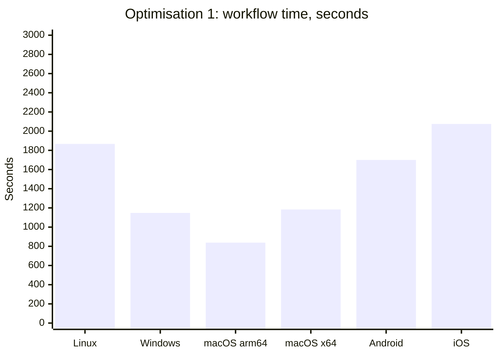

| Workflow | Workflow time | Slowest job |
|---|---|---|
| Test Linux | 31m 07s | app-smoke-tests 28m 36s |
| Test Windows | 19m 08s | app-smoke-tests 14m 21s |
| Test macOS arm64 | 13m 58s | app-smoke-tests 11m 34s |
| Test macOS x64 | 19m 44s | app-smoke-tests 12m 05s |
| Test Android | 28m 20s | app-smoke-tests 22m 55s |
| Test iOS | 34m 35s | app-smoke-tests 23m 19s |

### Job time

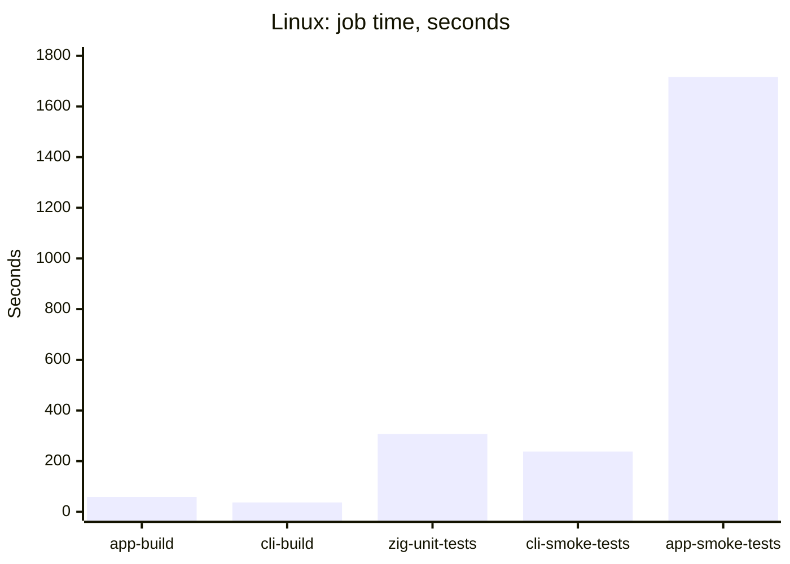

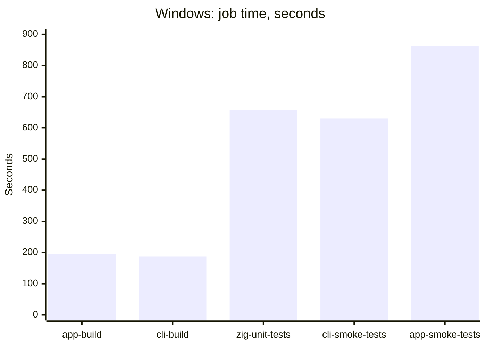

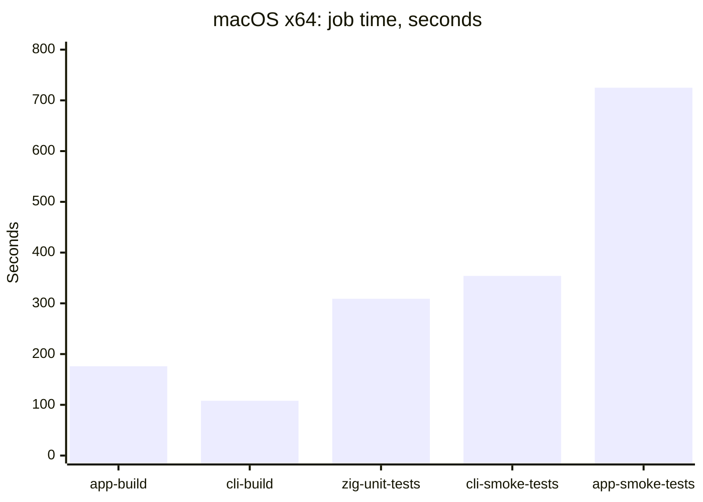

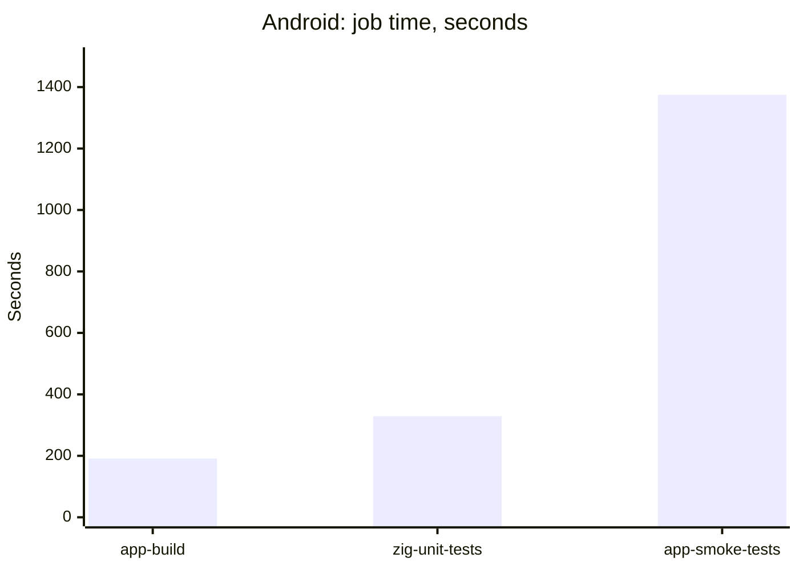

| Job | Linux | Windows | macOS arm64 | macOS x64 | Android | iOS |
|---|---|---|---|---|---|---|
| app-build | 59 | 196 | 90 | 176 | 191 | 357 |
| cli-build | 37 | 187 | 69 | 108 | n/a | n/a |
| zig-unit-tests | 307 | 657 | 280 | 309 | 329 | 280 |
| cli-smoke-tests | 238 | 630 | 132 | 354 | n/a | n/a |
| app-smoke-tests | 1716 | 861 | 694 | 725 | 1375 | 1399 |
| report | 4 | 3 | 3 | 5 | 3 | 3 |

The library builds, seconds:

| Job | Linux | Windows | macOS arm64 | macOS x64 | Android | iOS |
|---|---|---|---|---|---|---|
| build-aws-sdk | 13 | 66 | 30 | 35 | 91 | 31 |
| build-zlib-ng | 12 | 53 | 15 | 42 | 83 | 14 |
| build-imagemagick | 12 | 63 | 18 | 47 | 99 | 130 |
| build-ffmpeg | 19 | 80 | 42 | 101 | 90 | 161 |

### Step time

The steps that take the most, per platform, in seconds:

| Platform | Step | Time |
|---|---|---|
| Linux | app-smoke-tests: Run the Photosphere App smoke tests | 1646 |
| Linux | zig-unit-tests: Run the Zig unit tests | 227 |
| Linux | cli-smoke-tests: Run the Zig CLI smoke tests | 160 |
| Linux | typescript-unit-tests: Run unit tests | 52 |
| Linux | cli-smoke-tests: Install media processing tools (Linux) | 39 |
| macOS arm64 | app-smoke-tests: Run the Photosphere App smoke tests | 602 |
| macOS arm64 | zig-unit-tests: Run the Zig unit tests | 126 |
| macOS arm64 | cli-smoke-tests: Run the Zig CLI smoke tests | 72 |
| macOS arm64 | typescript-unit-tests: Run unit tests | 57 |
| macOS arm64 | zig-unit-tests: Install media processing tools (macOS) | 47 |
| Windows | app-smoke-tests: Run the Photosphere App smoke tests | 731 |
| Windows | cli-smoke-tests: Run the Zig CLI smoke tests | 446 |
| Windows | zig-unit-tests: Run the Zig unit tests | 418 |
| Windows | cli-build: Build the Zig CLI natively for Windows x64 | 102 |
| Windows | cli-smoke-tests: Cache Bun dependencies | 69 |
| macOS x64 | app-smoke-tests: Run the Photosphere App smoke tests | 589 |
| macOS x64 | cli-smoke-tests: Run the Zig CLI smoke tests | 216 |
| macOS x64 | zig-unit-tests: Run the Zig unit tests | 144 |
| macOS x64 | build-ffmpeg: Build FFmpeg | 77 |
| macOS x64 | typescript-unit-tests: Run unit tests | 52 |
| Android | app-smoke-tests: Run the Photosphere App Android smoke tests | 1189 |
| Android | zig-unit-tests: Run the Zig unit tests | 229 |
| Android | build-imagemagick: Set up the Android C library | 85 |
| Android | app-smoke-tests: Set up the Android C library | 85 |
| Android | build-aws-sdk: Set up the Android C library | 79 |
| iOS | app-smoke-tests: Run the Photosphere App iOS smoke tests | 1307 |
| iOS | app-build: Restore the third-party libraries for the iOS simulator | 262 |
| iOS | build-ffmpeg: Build FFmpeg | 151 |
| iOS | zig-unit-tests: Run the Zig unit tests | 128 |
| iOS | build-imagemagick: Build ImageMagick | 108 |

## Optimisation 2: no Node.js

Commit `2c929aaee`, "Dropped Node.js from the test workflows". Three jobs in each workflow installed Node.js and nothing in the repository runs `node`, so the step and its `NODE_VERSION` are gone from all six.

### Workflow time

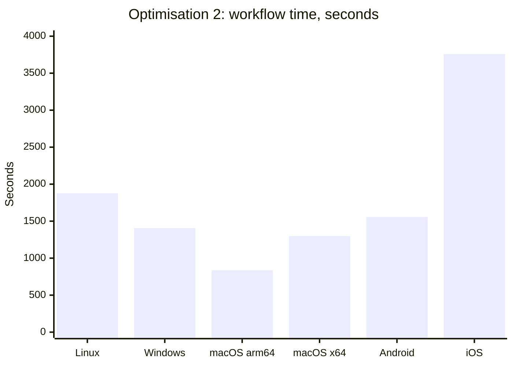

| Workflow | Optimisation 1 | Optimisation 2 | Change |
|---|---|---|---|
| Test Linux | 31m 07s | 31m 17s | 0.5% slower |
| Test Windows | 19m 08s | 23m 27s | 22.6% slower |
| Test macOS arm64 | 13m 58s | 13m 57s | unchanged |
| Test macOS x64 | 19m 44s | 21m 40s | 9.8% slower |
| Test Android | 28m 20s | 25m 58s | 8.4% faster |
| Test iOS | 34m 35s | 62m 36s | 81.0% slower |

The change removes one step of about ten seconds from each of three jobs, so it cannot move a workflow by minutes. What moved is the smoke suites: iOS 23m 19s to 48m 21s, Windows 14m 21s to 18m 57s, macOS arm64 11m 34s to 9m 07s. The same suites have now measured iOS smoke at 23m 19s and 48m 21s on two runs of trees that differ only in two deleted steps. These rows compare single runs, and a single smoke run is not stable enough to read a change of this size from.

### Job time

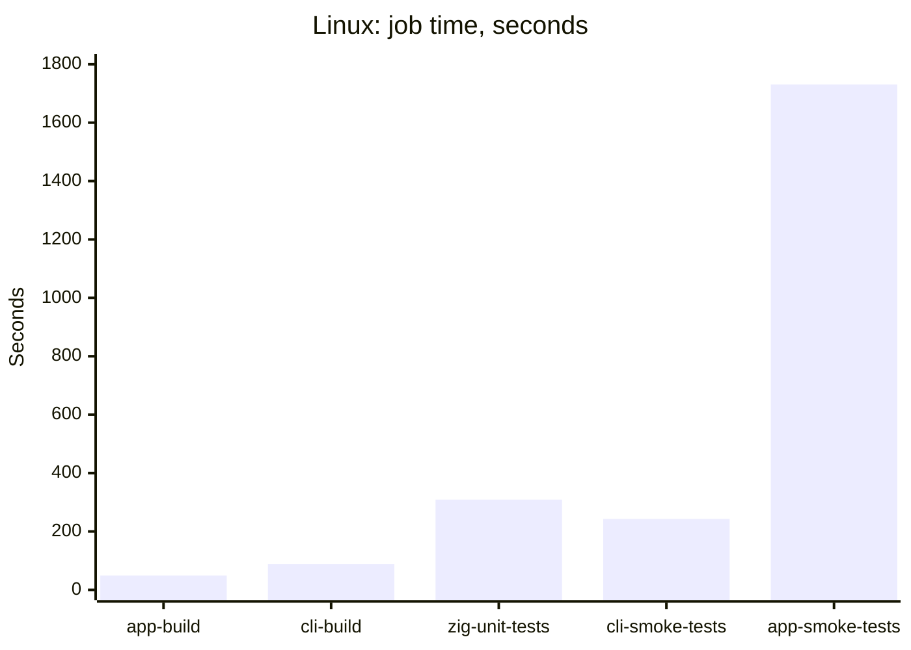

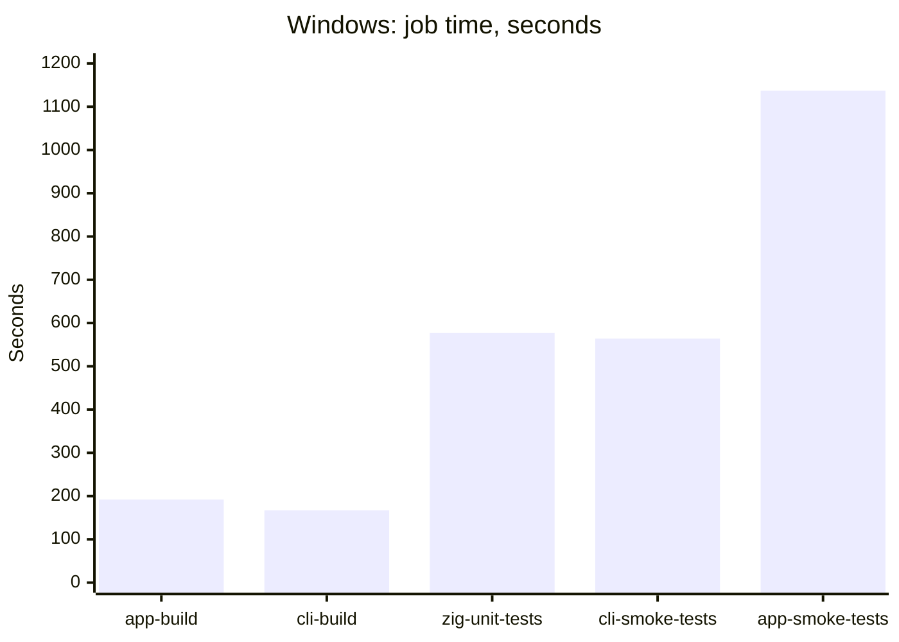

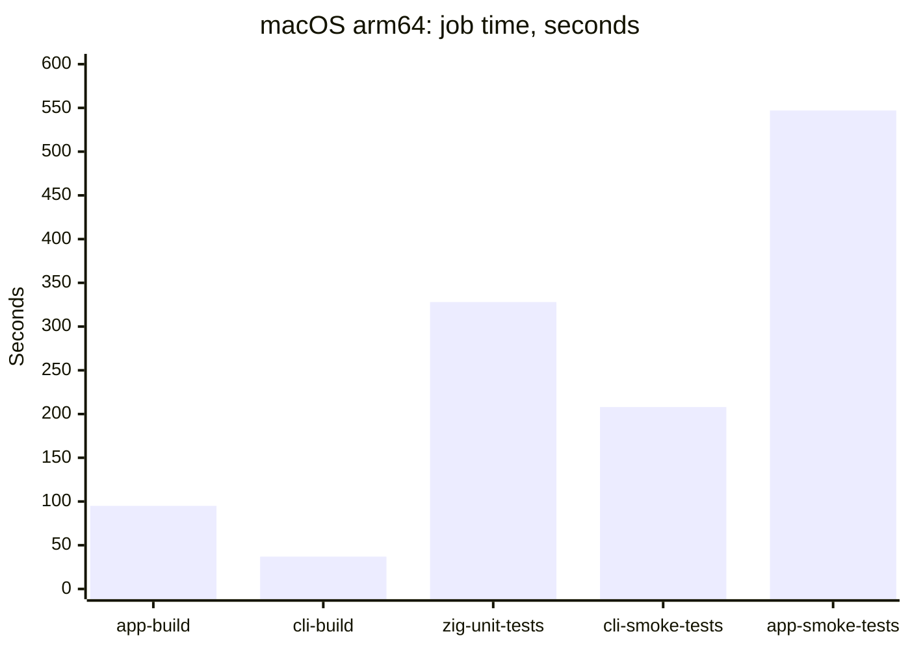

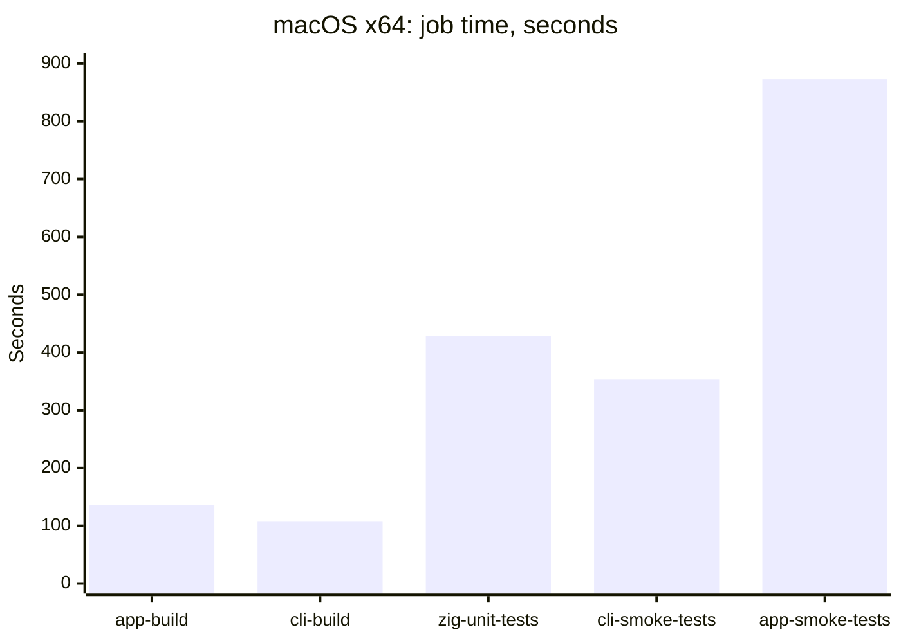

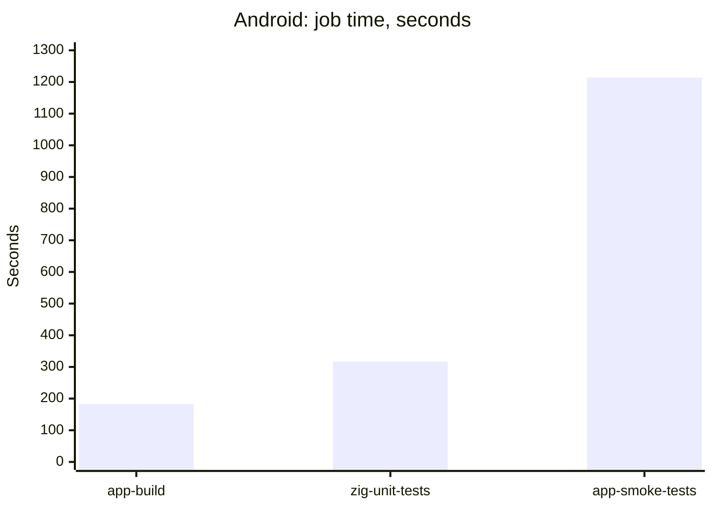

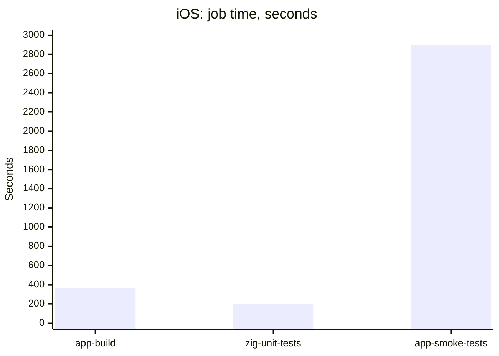

| Job | Linux | Windows | macOS arm64 | macOS x64 | Android | iOS |
|---|---|---|---|---|---|---|
| app-build | 49 | 192 | 95 | 136 | 183 | 364 |
| cli-build | 88 | 167 | 37 | 107 | n/a | n/a |
| zig-unit-tests | 309 | 577 | 328 | 429 | 317 | 202 |
| cli-smoke-tests | 243 | 564 | 208 | 353 | n/a | n/a |
| app-smoke-tests | 1731 | 1137 | 547 | 873 | 1214 | 2901 |
| report | 4 | 5 | 5 | 2 | 5 | 4 |

The library builds, seconds:

| Job | Linux | Windows | macOS arm64 | macOS x64 | Android | iOS |
|---|---|---|---|---|---|---|
| build-aws-sdk | 13 | 61 | 24 | 54 | 90 | 20 |
| build-zlib-ng | 12 | 58 | 19 | 42 | 101 | 24 |
| build-imagemagick | 13 | 62 | 29 | 55 | 77 | 128 |
| build-ffmpeg | 20 | 66 | 27 | 59 | 95 | 220 |

### Step time

The longest steps, per platform, in seconds:

| Platform | Step | Time |
|---|---|---|
| Linux | app-smoke-tests: Run the Photosphere App smoke tests | 1683 |
| Linux | zig-unit-tests: Run the Zig unit tests | 231 |
| Linux | cli-smoke-tests: Run the Zig CLI smoke tests | 204 |
| Windows | app-smoke-tests: Run the Photosphere App smoke tests | 943 |
| Windows | cli-smoke-tests: Run the Zig CLI smoke tests | 431 |
| Windows | zig-unit-tests: Run the Zig unit tests | 340 |
| macOS arm64 | app-smoke-tests: Run the Photosphere App smoke tests | 486 |
| macOS arm64 | zig-unit-tests: Run the Zig unit tests | 152 |
| macOS arm64 | cli-smoke-tests: Run the Zig CLI smoke tests | 126 |
| macOS x64 | app-smoke-tests: Run the Photosphere App smoke tests | 694 |
| macOS x64 | cli-smoke-tests: Run the Zig CLI smoke tests | 214 |
| macOS x64 | zig-unit-tests: Run the Zig unit tests | 213 |
| Android | app-smoke-tests: Run the Photosphere App Android smoke tests | 1032 |
| Android | zig-unit-tests: Run the Zig unit tests | 207 |
| Android | build-zlib-ng: Set up the Android C library | 91 |
| iOS | app-smoke-tests: Run the Photosphere App iOS smoke tests | 2739 |
| iOS | app-build: Restore the third-party libraries for the iOS simulator | 267 |
| iOS | build-ffmpeg: Build FFmpeg | 205 |
