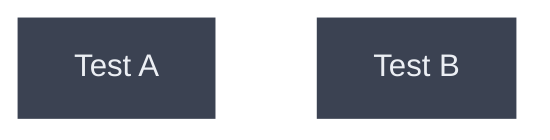
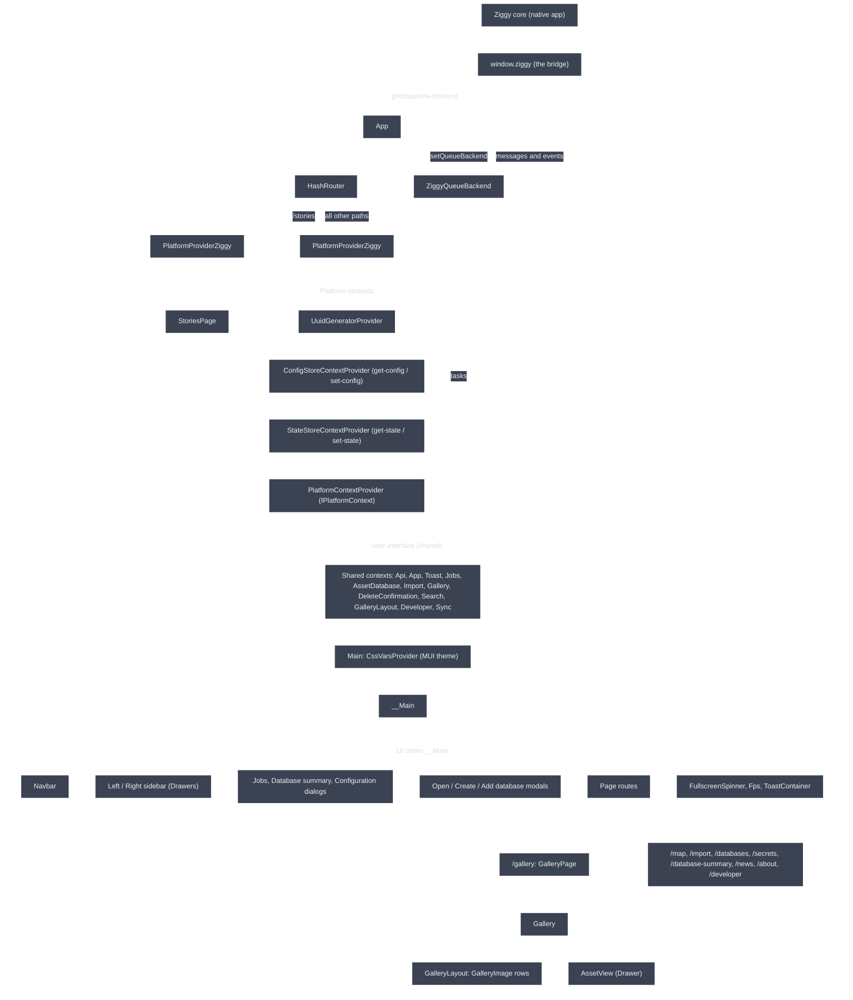

# How the frontend works

## Startup

- The native app injects `window.ziggy` before any script runs. The page throws if it is missing.
- The page asks the core for the platform (`desktop` or `mobile`, plus the OS) and renders `App` with the bridge and that answer.
- In test mode the page also forwards the console to the core and installs the DOM test driver.

## App

- `App` is the only place the providers are stacked. It is the composition root.
- It reads `restApiUrl` and the saved theme from the page's query string, sets the renderer log and sets the task queue backend.
- `/stories` gets the platform provider and the stories browser only. Every other path gets the full stack.
- `McpToolHandler` and `PreviewBanner` are mounted on desktop only.

## PlatformProviderZiggy

- The one place that knows about Ziggy. Everything below it talks to the core only through the contexts it provides.
- It turns bridge messages and events into four contexts:
  - `PlatformContext`: the `IPlatformContext` object (databases, vault, recents, pickers, tasks, sharing, menu actions, notifications, theme and network events).
  - `ConfigStoreContext` and `StateStoreContext`: key/value stores backed by the core's config file and state file, read through `useConfigStore()` and `useStateStore()`.
  - `UuidGenerator`.
- Desktop versus phone differences are decided here from `platform.platformKind`, not in the shared UI.

## The shared contexts

- All live in the shared `user-interface` package and contain no platform code.
- Order matters: a provider can only use contexts above it.
  - `AssetDatabaseProvider` uses the platform, the API, toasts and the uuid generator.
  - `ImportContextProvider` uses the asset database.
  - `GalleryContextProvider` uses the asset database and the state store.
  - `DeleteConfirmation`, `Search` and `GalleryLayout` use the gallery.
  - `Developer` and `Sync` use config and the platform.
- Assets are fetched over HTTP from `restApiUrl`. Database work runs as tasks through `ZiggyQueueBackend`.

## Main and \_\_Main

- `Main` is a wrapper whose only job is the MUI `CssVarsProvider`, so `__Main` can call `useColorScheme()` inside it.
- `__Main` is the app shell:
  - Owns the open/closed state of the sidebars, dialogs and modals.
  - Subscribes to platform events: menu actions, task messages, notifications (shown as toasts) and theme changes.
  - Opens the last database on first mount.
  - Renders the page routes inside `#content`. `/` redirects to `/gallery`.
