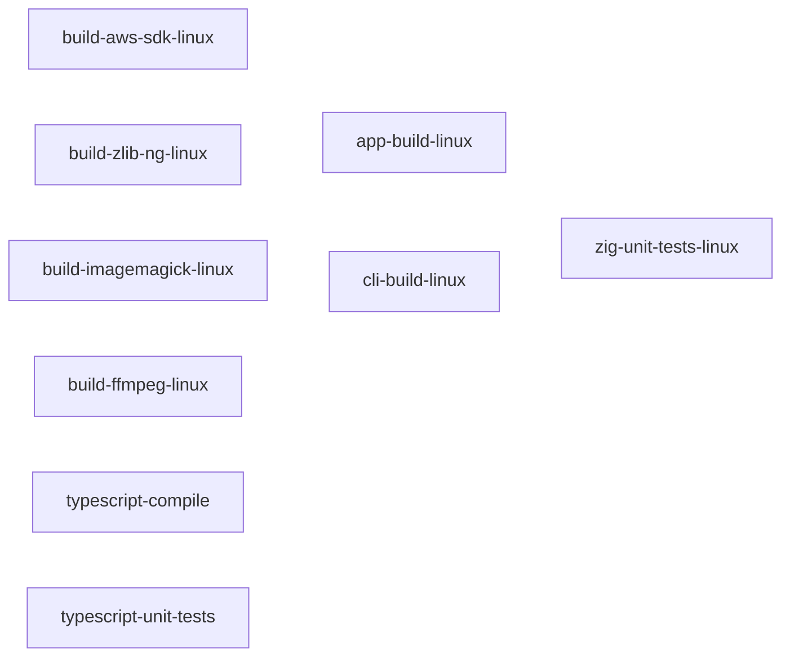
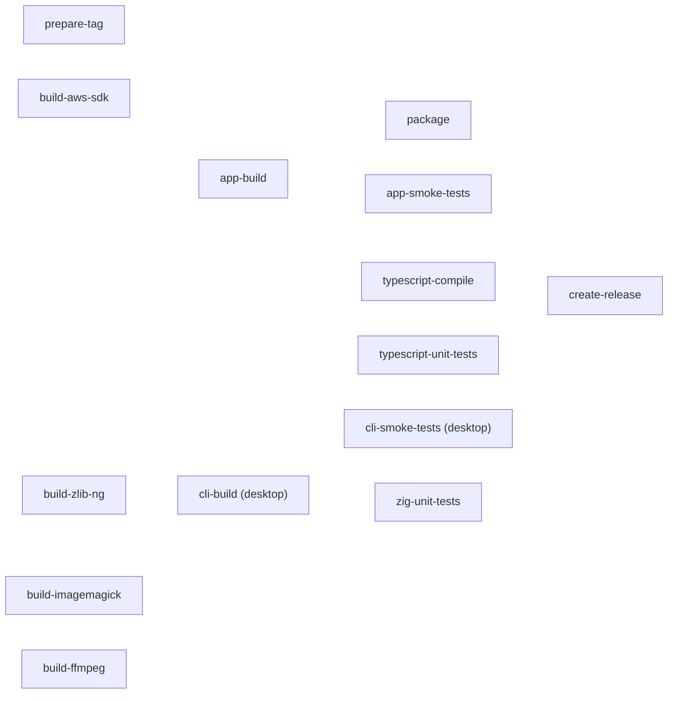

# Workflows

The jobs of the GitHub Actions workflows in `.github/workflows`, what each one needs, and where each one gets its input and puts its output. A release job hands what it built to the later jobs of the same run as a GitHub artifact (see "Handoffs between jobs" below), and the smoke test jobs upload their logs as an artifact when they fail (see "Smoke test logs"). The GitHub cache holds only real caches, which a job can do without: the third-party libraries, the Zig build caches, and the Bun and Zig package caches, which every job keeps and which are left out below.

A third-party library (the AWS SDK for C, zlib-ng, ImageMagick and FFmpeg) is built by its own build action in `.github/actions/build-<library>`, which caches it under a key made from the platform, the build arguments and the library's source, so the same library is built once whichever workflow asks for it. A job that needs the libraries restores them with the `third-party-libraries` action, which runs the same build actions and gets a cache hit.

## CI (`ci.yml`)

Runs on every push to a branch, every pull request into `main` and every manual run, on Linux only. It packages nothing and builds for no other platform: the release workflows do both.

```
ci.yml  "CI"
│
│   Library jobs: one job per library, for Linux.
│     needs:  none
│     output → GitHub cache (one key per library)
├── build-aws-sdk-linux                (ubuntu-latest)
├── build-zlib-ng-linux                (ubuntu-latest)
├── build-imagemagick-linux            (ubuntu-latest)
├── build-ffmpeg-linux                 (ubuntu-latest)
│
├── app-build-linux                    (ubuntu-latest)
│     needs:  the 4 library jobs
│     Builds the app. No packaging.
│     input  ← libraries from GitHub cache
│     output → none kept (it only proves the app builds)
├── cli-build-linux                    (ubuntu-latest)
│     needs:  the 4 library jobs
│     Builds the CLI.
│     input  ← libraries from GitHub cache
│     output → Zig build cache to GitHub cache (zig-build-<sha>)
├── typescript-compile                 (ubuntu-latest)
│     needs:  none
│     output → none
├── typescript-unit-tests              (ubuntu-latest)
│     needs:  none
│     output → none
└── zig-unit-tests-linux                     (ubuntu-latest)
      needs:  the 4 library jobs, cli-build-linux
      Runs zig build test.
      input  ← libraries; its own Zig build cache; the cli-build-linux
               Zig build cache (zig-build-<sha>), from GitHub cache
      output → Zig build cache to GitHub cache, for its next run
```

## Release (`release-<platform>.yml`)

One workflow per platform: `linux`, `windows`, `macos-arm64`, `macos-x64`, `android` and `ios`. See [Releasing](releasing.md) for what starts each one and the release it publishes.

```
release-<platform>.yml
├── prepare-tag
│   │ needs:  none
│   │ Works out the release tag.
│   │ output → job outputs (tag, is-release); with new-patch or
│   │          update-latest it also pushes a git tag to GitHub
│   └── linux                     (ubuntu-latest)
│
│   Library jobs: one job per library, for this platform.
│     needs:  none
│     output → GitHub cache
├── build-aws-sdk                      (<platform runner>)
├── build-zlib-ng                      (<platform runner>)
├── build-imagemagick                  (<platform runner>)
├── build-ffmpeg                       (<platform runner>)
│
├── app-build
│   │ needs:  prepare-tag, the 4 library jobs
│   │ Builds the app.
│   │ input  ← tag from job outputs; libraries from GitHub cache
│   │ output → artifact handoff-app-<platform>
│   └── <platform>                (<platform runner>)
├── cli-build  (desktop only)
│   │ needs:  prepare-tag, the 4 library jobs
│   │ Builds the CLI.
│   │ input  ← tag from job outputs; libraries and its Zig build cache
│   │          from GitHub cache
│   │ output → artifact handoff-cli-<platform>; its Zig build cache to
│   │          GitHub cache (zig-build-<sha>)
│   └── <platform>                (<platform runner>)
├── typescript-compile
│   │ needs:  none
│   │ output → none
│   └── linux                     (ubuntu-latest)
├── typescript-unit-tests
│   │ needs:  none
│   │ output → none
│   └── linux                     (ubuntu-latest)
├── zig-unit-tests
│   │ needs:  the 4 library jobs; cli-build on desktop, app-build on mobile
│   │ Runs zig build test.
│   │ input  ← the runner's libraries; its own Zig build cache; the Zig
│   │          build cache in handoff-cli-<platform> (desktop) or
│   │          handoff-app-<platform> (mobile)
│   │ output → Zig build cache to GitHub cache, for its next run
│   └── <platform>                (<platform runner>; ubuntu-latest for
│                                   android, macos-15 for ios)
├── cli-smoke-tests  (desktop only)
│   │ needs:  cli-build
│   │ input  ← artifact handoff-cli-<platform>
│   │ output → on failure only, the failed tests' directories as a GitHub
│   │          artifact (see "Smoke test logs" below)
│   └── <platform>                (<platform runner>)
├── app-smoke-tests
│   │ needs:  app-build; cli-build on desktop
│   │ input  ← artifact handoff-app-<platform> (and handoff-cli-<platform>
│   │          on desktop)
│   │ output → on failure only, the failed tests' directories as a GitHub
│   │          artifact (see "Smoke test logs" below)
│   └── <platform>                (<platform runner>)
├── package
│   │ needs:  prepare-tag, app-build
│   │ Packages the app.
│   │ input  ← tag from job outputs; artifact handoff-app-<platform>
│   │ output → artifact handoff-package-<platform>
│   └── <platform>                (<platform runner>)
└── create-release
    │ needs:  every other job
    │ input  ← tag from job outputs; artifact handoff-package-<platform>
    │          (and handoff-cli-<platform> on desktop)
    │ output → GitHub Release (the version tag, or <platform>-nightly)
    └── linux                     (ubuntu-latest)
```

The platform runner of each release workflow:

| Workflow | Runner |
|---|---|
| `release-linux.yml` | `ubuntu-latest` |
| `release-windows.yml` | `windows-latest` |
| `release-macos-arm64.yml` | `macos-latest` |
| `release-macos-x64.yml` | `macos-15-intel` |
| `release-android.yml` | `ubuntu-latest` |
| `release-ios.yml` | `macos-15` |

The Android library jobs build each library for the runner, Android x86_64 and Android arm64. The iOS library jobs build for the iOS simulator and an iOS device; the iOS `app-build` also restores the macOS arm64 libraries for the runner, which no job in that workflow builds, so on a cache miss it builds them itself.

## Dependency graphs

Each arrow points from a job to a job that needs it. A job with no arrow into it starts when the workflow starts.

### `ci.yml`



This diagram is drawn for dark mode only: its lines are white and do not show on a light background.

### `release-<platform>.yml`

`cli-build` and `cli-smoke-tests` are in the desktop workflows only (Linux, Windows and macOS). `zig-unit-tests` runs on the workflow's own runner and needs `cli-build` in the desktop workflows and `app-build` in the Android and iOS ones.



This diagram is drawn for dark mode only: its lines are white and do not show on a light background.

## Handoffs between jobs

A release job's output reaches the later jobs of the same run as a GitHub artifact, through two actions: `.github/actions/handoff-upload` packs the paths it is given into one gzipped tar archive and uploads it as `handoff-<name>`, and `.github/actions/handoff-download` downloads it and unpacks it into the workspace at the same paths. The tar archive is what keeps the executable bits, symbolic links (the frameworks inside a macOS `.app`) and file names exactly as they were, none of which an artifact of loose files keeps. The archive is written and read through standard output and input rather than `tar -f`, because GNU tar on the Windows runners takes the drive letter of a path for a remote host name.

| Artifact | Uploaded by | Holds | Downloaded by |
|---|---|---|---|
| `handoff-app-<platform>` | `app-build` | the app build, `.zig-cache` and the four libraries' `zig-out` | `app-smoke-tests`, `package`; `zig-unit-tests` on Android and iOS |
| `handoff-cli-<platform>` (desktop) | `cli-build` | `out` (the CLI binary), `.zig-cache` and the four libraries' `zig-out` | `cli-smoke-tests`, `app-smoke-tests`, `create-release` |
| `handoff-package-<platform>` | `package` | the packages in `out/package` | `create-release` |

Every job that downloads a handoff needs the job that uploads it, so the upload has finished first. A path that is missing or a glob that matches nothing fails the upload, and a handoff that is missing fails the download.

The artifacts are kept for 1 day, since only the later jobs of the same run read them. Re-running a failed job of a run more than a day old finds its handoff gone and fails, so re-run the whole workflow instead. Re-running every job uploads each handoff again over the earlier attempt's.

These handoffs used to be saves to the GitHub cache under a key holding the run id, restored with `fail-on-cache-miss`. The repository's caches pass GitHub's 10 GB limit when several pull requests run at once, and GitHub then evicts the least recently used entries, including ones an earlier job of a run still in progress had just saved, so a later job of that run failed its restore. GitHub does not evict an artifact before its retention runs out.

## Smoke test logs

When `cli-smoke-tests` or `app-smoke-tests` fails, the job copies the directories the failed tests kept (each holds the test's full log and the CLI's or app's own logs, and on macOS and iOS the crash reports go in `crash-reports/`) and uploads them as the artifact `cli-smoke-logs-<platform>` or `app-smoke-logs-<platform>`, kept for 5 days. The artifact holds a single tar archive, `cli-smoke-logs.tar.gz` or `app-smoke-logs.tar.gz`, because `actions/upload-artifact` refuses a file name containing a character Windows forbids, such as a double quote, and some smoke tests name their files that way on purpose. To read one:

```
gh run download <run-id> --name cli-smoke-logs-<platform> --dir tmp/cli-smoke-logs-<platform>
tar -xzf tmp/cli-smoke-logs-<platform>/cli-smoke-logs.tar.gz -C tmp/cli-smoke-logs-<platform>
```

## ImageMagick on the macOS runners

The macOS and iOS workflows install ImageMagick with [`scripts/brew-install-media-tools.sh`](../scripts/brew-install-media-tools.md), which pins its version, rather than with a plain `brew install imagemagick`, whose version moves with the runner image. The script's page says why and how.
