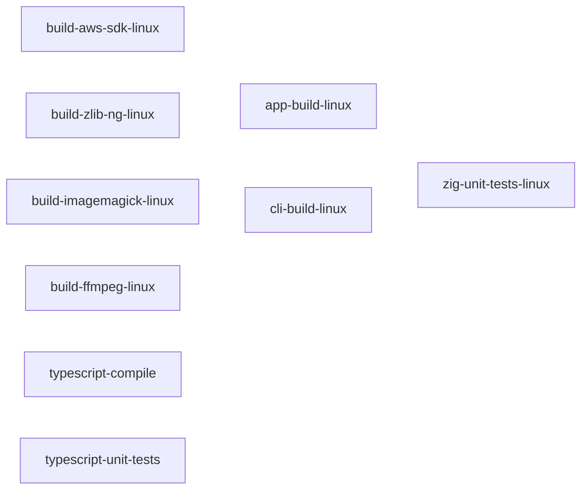
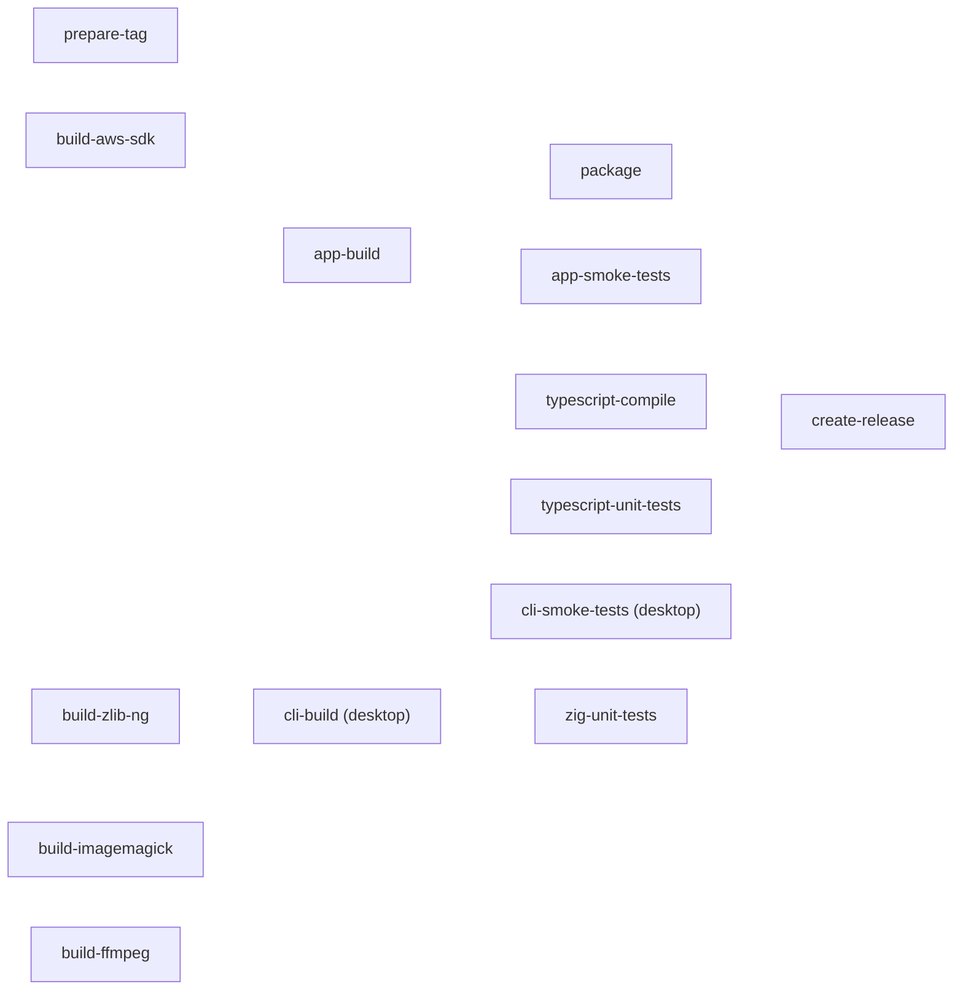

# Workflows

The jobs of the GitHub Actions workflows in `.github/workflows`, what each one needs, and where each one gets its input and puts its output. Jobs hand their output to each other through the GitHub Actions cache. No workflow uses GitHub artifacts. Every job also keeps the Bun and Zig package caches in the GitHub cache; they are left out below.

A third-party library (the AWS SDK for C, zlib-ng, ImageMagick and FFmpeg) is built by its own build action in `.github/actions/build-<library>`, which caches it under a key made from the platform, the build arguments and the library's source, so the same library is built once whichever workflow asks for it. A job that needs the libraries restores them with the `third-party-libraries` action, which runs the same build actions and gets a cache hit.

## CI (`ci.yml`)

Runs on every push to a branch, every pull request into `main` and every manual run, on Linux only. It packages nothing and builds for no other platform: the release workflows do both.

```
ci.yml  "CI"
│
│   Library jobs: one job per library, for Linux.
│     needs:  none
│     output → GitHub cache (one key per library)
├── build-aws-sdk-linux                (ubuntu-latest)
├── build-zlib-ng-linux                (ubuntu-latest)
├── build-imagemagick-linux            (ubuntu-latest)
├── build-ffmpeg-linux                 (ubuntu-latest)
│
├── app-build-linux                    (ubuntu-latest)
│     needs:  the 4 library jobs
│     Builds the app. No packaging.
│     input  ← libraries from GitHub cache
│     output → none kept (it only proves the app builds)
├── cli-build-linux                    (ubuntu-latest)
│     needs:  the 4 library jobs
│     Builds the CLI.
│     input  ← libraries from GitHub cache
│     output → Zig build cache to GitHub cache (zig-build-<sha>)
├── typescript-compile                 (ubuntu-latest)
│     needs:  none
│     output → none
├── typescript-unit-tests              (ubuntu-latest)
│     needs:  none
│     output → none
└── zig-unit-tests-linux                     (ubuntu-latest)
      needs:  the 4 library jobs, cli-build-linux
      Runs zig build test.
      input  ← libraries; its own Zig build cache; the cli-build-linux
               Zig build cache (zig-build-<sha>), from GitHub cache
      output → Zig build cache to GitHub cache, for its next run
```

## Release (`release-<platform>.yml`)

One workflow per platform: `linux`, `windows`, `macos-arm64`, `macos-x64`, `android` and `ios`. See [Releasing](releasing.md) for what starts each one and the release it publishes.

```
release-<platform>.yml
├── prepare-tag
│   │ needs:  none
│   │ Works out the release tag.
│   │ output → job outputs (tag, is-release); with new-patch or
│   │          update-latest it also pushes a git tag to GitHub
│   └── linux                     (ubuntu-latest)
│
│   Library jobs: one job per library, for this platform.
│     needs:  none
│     output → GitHub cache
├── build-aws-sdk                      (<platform runner>)
├── build-zlib-ng                      (<platform runner>)
├── build-imagemagick                  (<platform runner>)
├── build-ffmpeg                       (<platform runner>)
│
├── app-build
│   │ needs:  prepare-tag, the 4 library jobs
│   │ Builds the app.
│   │ input  ← tag from job outputs; libraries from GitHub cache
│   │ output → GitHub cache (photosphere-app-<platform>)
│   └── <platform>                (<platform runner>)
├── cli-build  (desktop only)
│   │ needs:  prepare-tag, the 4 library jobs
│   │ Builds the CLI.
│   │ input  ← tag from job outputs; libraries and its Zig build cache
│   │          from GitHub cache
│   │ output → GitHub cache (photosphere-cli-<platform>, and its Zig
│   │          build cache)
│   └── <platform>                (<platform runner>)
├── typescript-compile
│   │ needs:  none
│   │ output → none
│   └── linux                     (ubuntu-latest)
├── typescript-unit-tests
│   │ needs:  none
│   │ output → none
│   └── linux                     (ubuntu-latest)
├── zig-unit-tests
│   │ needs:  the 4 library jobs; cli-build on desktop, app-build on mobile
│   │ Runs zig build test.
│   │ input  ← the runner's libraries; its own Zig build cache; the Zig
│   │          build cache cli-build or app-build saved, from GitHub cache
│   │ output → Zig build cache to GitHub cache, for its next run
│   └── <platform>                (<platform runner>; ubuntu-latest for
│                                   android, macos-15 for ios)
├── cli-smoke-tests  (desktop only)
│   │ needs:  cli-build
│   │ input  ← photosphere-cli-<platform> from GitHub cache
│   │ output → none
│   └── <platform>                (<platform runner>)
├── app-smoke-tests
│   │ needs:  app-build
│   │ input  ← photosphere-app-<platform> from GitHub cache
│   │ output → none
│   └── <platform>                (<platform runner>)
├── package
│   │ needs:  prepare-tag, app-build
│   │ Packages the app.
│   │ input  ← tag from job outputs; photosphere-app-<platform> from
│   │          GitHub cache
│   │ output → GitHub cache (photosphere-package-<platform>)
│   └── <platform>                (<platform runner>)
└── create-release
    │ needs:  every other job
    │ input  ← tag from job outputs; package (and the CLI on desktop)
    │          from GitHub cache
    │ output → GitHub Release (the version tag, or <platform>-nightly)
    └── linux                     (ubuntu-latest)
```

The platform runner of each release workflow:

| Workflow | Runner |
|---|---|
| `release-linux.yml` | `ubuntu-latest` |
| `release-windows.yml` | `windows-latest` |
| `release-macos-arm64.yml` | `macos-latest` |
| `release-macos-x64.yml` | `macos-15-intel` |
| `release-android.yml` | `ubuntu-latest` |
| `release-ios.yml` | `macos-15` |

The Android library jobs build each library for the runner, Android x86_64 and Android arm64. The iOS library jobs build for the iOS simulator and an iOS device; the iOS `app-build` also restores the macOS arm64 libraries for the runner, which no job in that workflow builds, so on a cache miss it builds them itself.

## Dependency graphs

Each arrow points from a job to a job that needs it. A job with no arrow into it starts when the workflow starts.

### `ci.yml`



This diagram is drawn for dark mode only: its lines are white and do not show on a light background.

### `release-<platform>.yml`

`cli-build` and `cli-smoke-tests` are in the desktop workflows only (Linux, Windows and macOS). `zig-unit-tests` runs on the workflow's own runner and needs `cli-build` in the desktop workflows and `app-build` in the Android and iOS ones.



This diagram is drawn for dark mode only: its lines are white and do not show on a light background.

